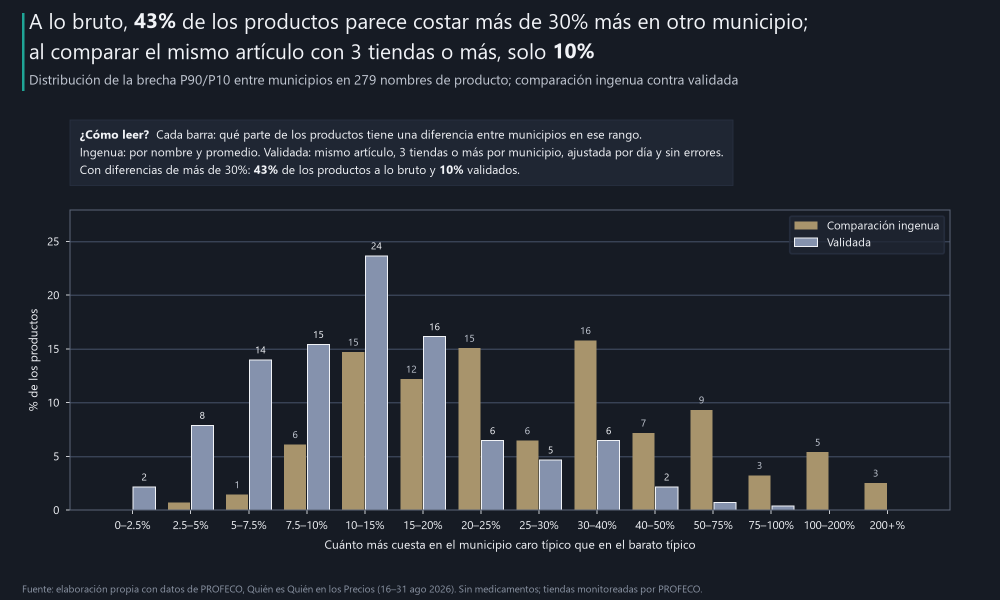
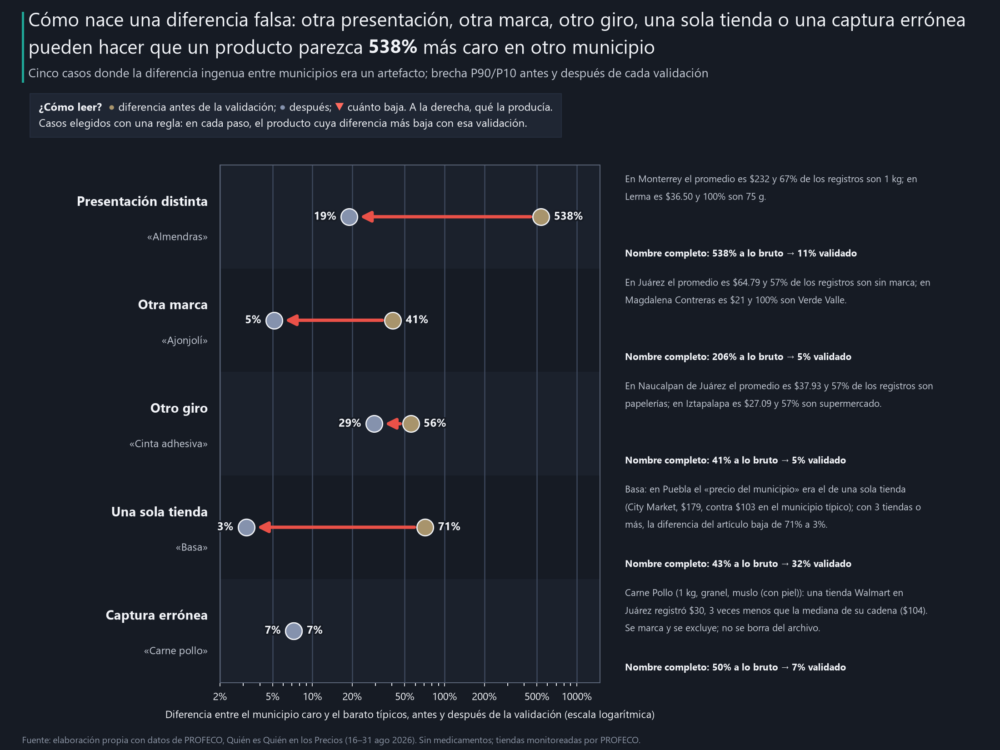
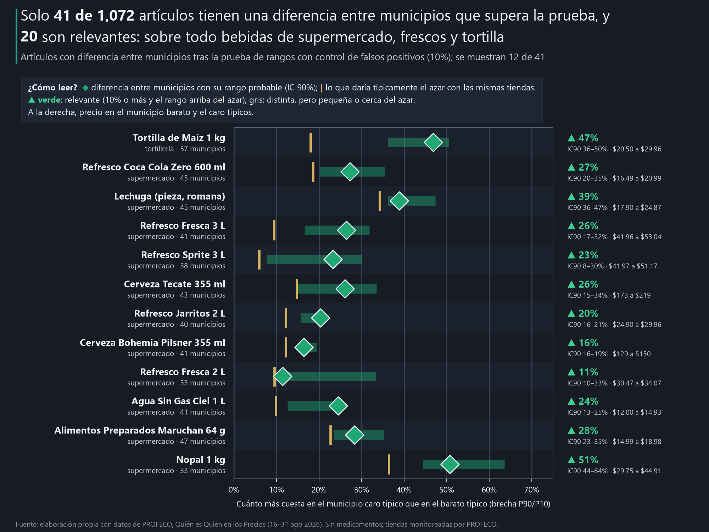
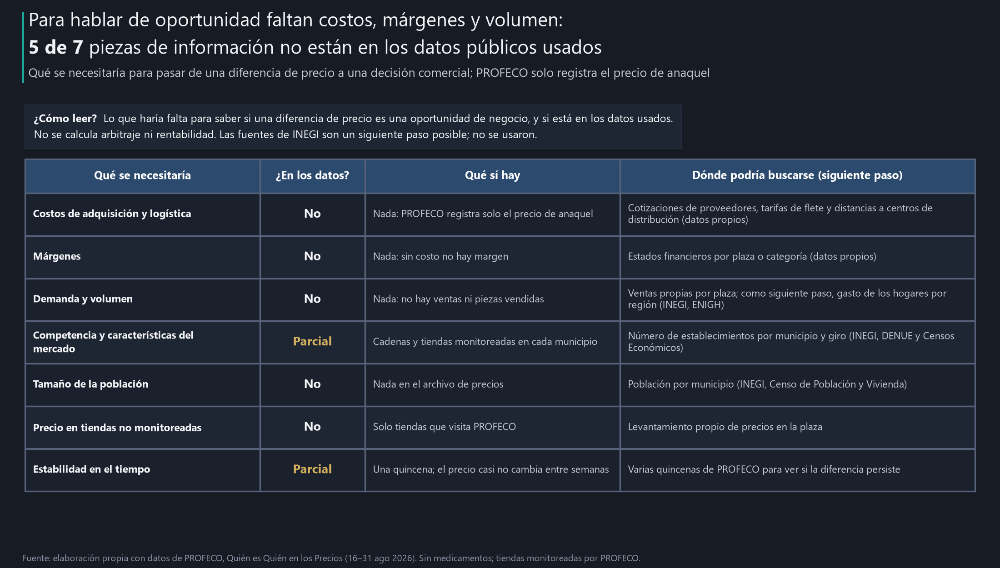

# Una diferencia de precio entre ciudades no es una oportunidad de negocio

**Objetivo.** Medir cuánto de una diferencia de precio entre municipios se mantiene cuando se comparan productos, presentaciones y periodos equivalentes, y distinguir lo que los datos públicos permiten afirmar de lo que haría falta para evaluar una oportunidad de negocio.

**Cuando un mismo producto parece más caro en un municipio que en otro, ¿qué parte de esa diferencia se sostiene al validar que se compara lo mismo, y qué información adicional se necesitaría para interpretarla como oportunidad?**

**[Ver el reporte interactivo](https://ernestrr.github.io/mexico-diferencias-precio-municipios/)**: la historia en cinco pasos, el embudo de comparabilidad y un selector para revisar cada producto.

## El problema

Un reporte dice que un producto cuesta **25% más** en otra ciudad. Antes de abrir una plaza, mover precios o negociar con un proveedor, la pregunta es si esa diferencia existe o si es un efecto de cómo se comparó.

## El hallazgo

**Al comparar el mismo artículo, la diferencia típica entre municipios baja de 25% a 11.7%, casi lo mismo que daría el azar (10.9%).**


| Indicador | Cifra |
|---|---|
| Diferencia típica a lo bruto | **25%** |
| Al comparar el mismo artículo | **11.7%** ($\color{#ff6b5f}{\blacktriangledown~-13.3}$ pp) |
| Lo que daría el azar con las mismas tiendas | 10.9% |
| Parte de la diferencia ingenua que desaparece | **53%** $\color{#ff6b5f}{\blacktriangledown}$ |
| Artículos con diferencia relevante | 21 de 1,238 |

*Brecha P90/P10 = cuánto más cuesta un producto en el municipio caro típico que en el barato típico. IC90 = rango probable. Verde ▲ = sube o es positivo; rojo ▼ = baja o es negativo.*

## 1. A lo bruto, todo parece una oportunidad



- Agrupando por nombre de producto, **43%** de los productos parece costar más de 30% más en otro municipio.
- Al validar, solo **10%**: $\color{#ff6b5f}{\blacktriangledown~-34}$ pp.

## 2. Al comparar lo mismo, la diferencia se encoge

| Paso | Diferencia típica | Cambio |
|---|---|---|
| 0. Comparación ingenua | **25.0%** | — |
| 1. Misma presentación | **20.4%** | $\color{#ff6b5f}{\blacktriangledown~-4.5}$ pp |
| 2. Mismo artículo | **17.7%** | $\color{#ff6b5f}{\blacktriangledown~-2.7}$ pp |
| 3. Mismo giro | **17.0%** | $\color{#ff6b5f}{\blacktriangledown~-0.7}$ pp |
| 4. 3 tiendas o más | **11.6%** | $\color{#ff6b5f}{\blacktriangledown~-5.4}$ pp |
| 5. Mismo periodo | **11.7%** | $\color{#3fcf95}{\blacktriangle~+0.1}$ pp |
| 6. Sin errores de captura | **11.7%** | $\color{#ff6b5f}{\blacktriangledown~-0.1}$ pp |
| Referencia: azar | 10.9% |  |

- La **presentación** ($\color{#ff6b5f}{\blacktriangledown~-4.5}$ pp) y el **número de tiendas** ($\color{#ff6b5f}{\blacktriangledown~-5.4}$ pp) hacen casi todo el trabajo.
- La fecha de captura y los errores casi no cambian nada: 81% de los precios es igual entre semanas.
- Lo que queda (11.7%) apenas supera al azar (10.9%): $\color{#3fcf95}{\blacktriangle~+0.7}$ pp. Es diferencia entre tiendas, no entre municipios.

## 3. Cómo nace una diferencia falsa



| Qué lo producía | Producto | Antes | Después | Cambio |
|---|---|---|---|---|
| Presentación distinta | Almendras | 538% | 19% | $\color{#ff6b5f}{\blacktriangledown~-519}$ pp |
| Otra marca | Ajonjolí | 41% | 5% | $\color{#ff6b5f}{\blacktriangledown~-36}$ pp |
| Otro giro | Cinta Adhesiva | 56% | 29% | $\color{#ff6b5f}{\blacktriangledown~-26}$ pp |
| Una sola tienda | Basa | 71% | 3% | $\color{#ff6b5f}{\blacktriangledown~-68}$ pp |
| Captura errónea | Carne Pollo | 7% | 7% | = 0.0 pp |

- Caso extremo: **Almendras**, 538% a lo bruto. En Monterrey el promedio es \$232 y 67% de los registros son 1 kg; en Lerma es \$36.50 y 100% son 75 g.

## 4. Lo que sí sobrevive



| Artículo | Giro | Diferencia | IC90 | Barato → caro típico |
|---|---|---|---|---|
| Tortilla de Maíz (1 kg, granel) | tortillería | $\color{#3fcf95}{\blacktriangle~+47}$% | 36–50% | Iztapalapa \$20.50 → Benito Juárez (Quintana Roo) \$29.96 |
| Refresco Coca Cola Zero (botella 600 ml) | supermercado | $\color{#3fcf95}{\blacktriangle~+27}$% | 20–35% | Miguel Hidalgo \$16.49 → San Luis Potosí \$20.99 |
| Refresco Fresca (botella 3 lt, no retornable) | supermercado | $\color{#3fcf95}{\blacktriangle~+26}$% | 17–32% | Benito Juárez (Ciudad de México) \$41.96 → Culiacán \$53.04 |
| Refresco Sprite (botella 3 lt, no retornable) | supermercado | $\color{#3fcf95}{\blacktriangle~+23}$% | 8–30% | Benito Juárez (Ciudad de México) \$41.97 → Hermosillo \$51.17 |
| Cerveza Tecate (paquete con 12 latas de 355 ml) | supermercado | $\color{#3fcf95}{\blacktriangle~+26}$% | 15–34% | La Paz \$173 → Tlalnepantla \$219 |
| Refresco Jarritos (botella 2 lt, no retornable, tamarindo) | supermercado | $\color{#3fcf95}{\blacktriangle~+20}$% | 16–21% | Venustiano Carranza \$24.90 → Guadalajara \$29.96 |
| Cerveza Bohemia Pilsner (canasta con 6 botellas de 355 ml, no retornab…) | supermercado | $\color{#3fcf95}{\blacktriangle~+16}$% | 16–19% | Naucalpan de Juárez \$129 → Tampico \$150 |
| Cerveza Indio (paquete con 12 latas de 355 ml) | supermercado | $\color{#3fcf95}{\blacktriangle~+34}$% | 25–42% | Hermosillo \$163 → Iztapalapa \$219 |

- **45 de 1,238** artículos pasan la prueba contra el azar; **21** con una diferencia de 10% o más.
- Sobre todo bebidas de supermercado (10) y frescos (6). Ahí la misma cadena cobra distinto por plaza: $\color{#3fcf95}{\blacktriangle~+13}$% contra $\color{#3fcf95}{\blacktriangle~+1.3}$% en el resto.

## 5. Antes de decidir: lo que falta



- Una diferencia que sobrevive es una **pregunta, no una oportunidad**: 5 de 7 piezas de información no están en los datos públicos.
- No se calcula arbitraje ni rentabilidad: no hay costos, márgenes ni volumen.

## Lo que no resultó sólido

- **24 de 45** artículos pasan la prueba con diferencias menores a 10% o pegadas al azar: distintos, pero no relevantes.
- **Medicamentos** quedan aparte: sin laboratorio en el dato, la diferencia validada (16.3%) sigue mezclando productos.
- **Tortillerías:** casi todas son independientes; no se puede separar cadena de lugar.

## Qué hacer con esto

Aplica a las tiendas que monitorea PROFECO y solo al precio al consumidor. **No es una recomendación de inversión ni un cálculo de arbitraje o rentabilidad**: no hay costos, márgenes ni volumen en los datos.

| Para | Acción |
|---|---|
| **Dirección** | No abrir plaza ni mover precios por una diferencia de reporte; pedir costo, margen y volumen de esa plaza. |
| **Comercial o ventas** | Revisar bebidas y frescos: ahí hay precio por zona que conviene entender con el proveedor regional. |
| **Análisis** | Comparar el mismo artículo, con 3 tiendas o más por municipio, contra el azar y con corrección por pruebas múltiples. |

## Cómo se hizo

- **Datos:** PROFECO, Quién es Quién en los Precios, 16–31 ago 2026; 279 productos, sin medicamentos.
- **Embudo:** presentación → marca y variedad → giro → 3 tiendas o más por municipio → día de captura → errores de captura.
- **Diferencia:** brecha P90/P10 = cuánto más cuesta en el municipio caro típico que en el barato típico.
- **Incertidumbre:** IC90 (rango probable) por bootstrap de municipios; prueba de rangos con control de falsos positivos y referencia de azar.

## Limitaciones

- Solo precio al consumidor en tiendas monitoreadas por PROFECO, en una quincena.
- Sin costos, márgenes ni volumen; ningún resultado implica causalidad.

## Método detallado

<details>
<summary>Ver tablas de sensibilidad y detalle por notebook</summary>

**Notebook 00 · Datos y decisiones.** 61% de los nombres de producto tiene más de
una presentación y 59% más de una marca. 18 municipios se
capturaron en uno o dos días. Posibles errores de captura: 240 precios fuera de 0.5×–2× la mediana de
su propia cadena (contra la mediana nacional serían 815, casi todos diferencias reales).

**Notebook 01 · Comparación ingenua.** Brecha mediana 25.0% (IC90 23.3–28.2%);
20% de los nombres supera 50%.

**Notebook 02 · Embudo.**

| Paso | Diferencia típica | IC90 |
|---|---|---|
| 0. Comparación ingenua | 25.0% | 23.3–28.2% |
| 1. Misma presentación | 20.4% | 18.1–21.1% |
| 2. Mismo artículo (marca y variedad) | 17.7% | 16.4–18.8% |
| 3. Mismo giro | 17.0% | 15.4–17.8% |
| 4. 3 tiendas o más | 11.6% | 10.4–12.8% |
| 5. Ajuste por día | 11.7% | 10.4–12.8% |
| 6. Sin errores de captura | 11.7% | 10.4–12.7% |
| Referencia: azar | 10.9% | |

Cada validación sola, frente a la ingenua (25.0%): misma presentación 20.4%, misma
marca 21.7%, mismo giro 37.5% (sube: separar giros sin definir el artículo deja mezclas en
canales chicos) y 3 tiendas o más 25.7%. Las validaciones funcionan juntas, no por separado.

| Variante | Ingenua | Validada |
|---|---|---|
| Principal (3 tiendas, sin errores) | 25.0% | 11.7% |
| Con todos los precios | 25.0% | 11.7% |
| 2 tiendas o más | 26.2% | 13.9% |
| 5 tiendas o más | 22.7% | 8.3% |
| Solo semana 1 | 26.1% | 12.8% |
| Solo semana 2 | 27.4% | 11.8% |
| Solo medicamentos | 18.1% | 16.3% |

**Notebook 03 · Diferencias que sobreviven.** 138 artículos con valor p < 0.05 sin corrección (se esperarían
62 por azar); 45 con control de falsos positivos; 21 relevantes.

**Notebook 04 · Artefactos y lo que falta.** Cinco casos elegidos con una regla y la tabla de información faltante.

**Notebook 05 · Visualizaciones, README y reporte.**

</details>

## Fuentes

Gráficas y cifras: elaboración propia con datos de PROFECO. Color por signo en las gráficas: verde ▲ = valor positivo; rojo ▼ = negativo; dorado = referencia.

- **PROFECO**, Quién es Quién en los Precios: archivo `08-2026_Q2.csv` (16–31 ago 2026). **URL oficial del programa:** https://qqp.profeco.gob.mx/

## Estructura y reproducción

<details>
<summary>Ver estructura y pasos</summary>

```
mexico-diferencias-precio-municipios/
├── notebooks/        00 datos y decisiones · 01 comparación ingenua · 02 embudo de comparabilidad
│                     03 diferencias que sobreviven · 04 artefactos y lo que falta · 05 visualizaciones
├── config.yaml       objetivo, preguntas y textos del README y del reporte
├── src/              entorno.py, embudo.py (pasos, brechas, bootstrap, prueba y azar), graficas.py, reporte.py
├── data/processed/   embudo, brecha por producto y paso, artículos probados, casos y resultados.json (CSV)
├── data/metadata/    parametros.json, manifiesto_insumos.json
├── outputs/charts/   gráficas PNG (la principal también en SVG)
├── outputs/social/   versiones de 1280×720 y 1080×1350
├── docs/index.html   reporte interactivo autocontenido con selector de producto
├── build_notebooks.py
└── verify_project.py
```

```powershell
python -m pip install -r requirements.txt
python build_notebooks.py
$env:OMP_NUM_THREADS = 1; $env:OPENBLAS_NUM_THREADS = 1; $env:MKL_NUM_THREADS = 1
foreach ($n in Get-ChildItem notebooks/0*.ipynb) {
  python -m jupyter nbconvert --to notebook --execute --inplace --ExecutePreprocessor.timeout=3600 $n.FullName
}
python verify_project.py
```

`verify_project.py` recalcula la comparación ingenua y la validada solo con pandas y numpy a partir de los precios
originales y comprueba que coinciden con este README.


</details>

---

**Autor:** Ernesto Roldán | Business Intelligence & Analytics | Inteligencia económica aplicada a pricing y rentabilidad
