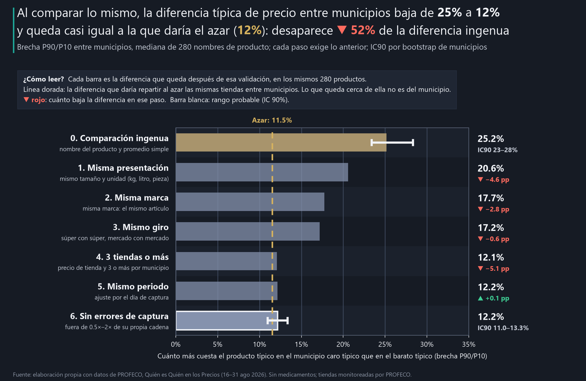

# Una diferencia de precio entre ciudades no es una oportunidad de negocio

**Objetivo.** Medir cuánto de una diferencia de precio entre municipios se mantiene cuando se comparan productos, presentaciones y periodos equivalentes, y distinguir lo que los datos públicos permiten afirmar de lo que haría falta para evaluar una oportunidad de negocio.

**Cuando un mismo producto parece más caro en un municipio que en otro, ¿qué parte de esa diferencia se sostiene al validar que se compara lo mismo, y qué información adicional se necesitaría para interpretarla como oportunidad?**

**[Ver el reporte interactivo](https://ernestrr.github.io/mexico-diferencias-precio-municipios/)**: la historia en cinco pasos, el embudo de comparabilidad y un selector para revisar cada producto.

## El hallazgo principal

**Al comparar el mismo artículo, la diferencia típica de precio entre municipios baja de 25% a 12.2% (IC90 11.0–13.3%), y ese 12.2% es casi lo mismo que daría repartir al azar las mismas tiendas entre los municipios (11.5%).** A lo bruto, agrupando por nombre de producto y con promedios, el producto típico parece costar 25% más en el municipio caro típico que en el barato típico. Al exigir la misma presentación, marca y giro, y al menos 3 tiendas por municipio, desaparece 52% de esa diferencia (IC90 47–59%). Lo que queda es, sobre todo, diferencia entre tiendas y no entre municipios: en el producto típico, la parte propia del municipio es de 0.2 puntos.



Brecha P90/P10 = cuánto más cuesta un producto en el municipio caro típico que en el barato típico. Se mide en los mismos 280 nombres de producto en cada paso (sin medicamentos). IC90 = rango probable.

## Tres hallazgos de apoyo

1. **Dos validaciones hacen casi todo el trabajo: la presentación y el número de tiendas.** Exigir la misma presentación baja la diferencia de 25.2% a 20.6%; exigir 3 tiendas o más por municipio, de 17.2% a 12.1%. En 47% de los cruces artículo–municipio, «el precio del municipio» es el de una sola tienda. El caso extremo es «Almendras»: a lo bruto, una diferencia de 538%. En Monterrey el promedio es $232 y 67% de los registros son 1 kg; en Lerma es $36.50 y 100% son 75 g. Con la misma presentación, 19%. Ninguna validación sola basta: exigir 3 tiendas sin definir antes el artículo casi no cambia la diferencia (25.8%).
2. **De 1,072 artículos comparables, solo 41 tienen una diferencia entre municipios que supera la prueba, y 20 son relevantes** (10% o más y claramente arriba del azar): 9 bebidas de supermercado, 5 frescos, 2 de tortilla y 4 de otros productos. Ejemplos: Tortilla de Maíz 1 kg en tortillerías, 29.96 pesos en Benito Juárez (Quintana Roo) contra 20.50 en Iztapalapa (diferencia 47%, IC90 36–50%); Refresco Coca Cola Zero 600 ml en supermercados, 27% (IC90 20–35%). En los artículos que sobreviven, la misma cadena cobra 13% más en el municipio caro típico; en los demás, 1.5%.
3. **El resultado no depende de los criterios.** Con 2 tiendas por municipio la diferencia validada es 14.4% y con 5, 9.7%; con solo la primera semana, 13.3%, y con solo la segunda, 12.3%. La fecha de captura casi no importa: 81% de los precios de la misma tienda y artículo no cambia entre semanas y el efecto del día es de 0.4% como máximo.

**Lo que no resultó sólido.** 21 de los 41 artículos que pasan la prueba tienen diferencias menores a 10% o un rango probable que toca lo típico del azar: son estadísticamente distintos, pero no relevantes para una decisión. Otros 81 artículos parecerían distintos con una prueba sin corrección (con más de mil pruebas, unos 54 saldrían así solo por azar). En tortillerías, «misma cadena» no aplica: casi todas son negocios independientes, así que su diferencia no se puede separar entre cadena y lugar. Los medicamentos quedan fuera: sin laboratorio en el dato, la diferencia validada (16.2%) sigue mezclando productos distintos.

## Qué significa para el negocio y qué hacer

Aplica a las tiendas que monitorea PROFECO y solo al precio al consumidor. **No es una recomendación de inversión ni un cálculo de arbitraje o rentabilidad**: no hay costos, márgenes ni volumen en los datos.

**Director o dueño de cadena**
- **No abra una plaza ni mueva precios por una diferencia de un reporte.** A lo bruto, 44% de los productos parece costar más de 30% más en otro municipio; al comparar lo mismo, la diferencia típica es 12.2%, casi lo que daría el azar.
- **Pida las cinco preguntas antes de decidir:** ¿es el mismo artículo?, ¿cuántas tiendas hay detrás?, ¿supera al azar?, ¿la misma cadena cobra distinto?, ¿persiste en otra quincena?
- **Si una diferencia sobrevive, es para investigar con datos propios:** costo puesto en tienda, margen y volumen de esa plaza. Sin eso no hay caso de negocio.

**Equipo comercial o de ventas**
- **Mire las bebidas y los frescos.** Es donde sobreviven las diferencias (9 bebidas y 5 frescos relevantes) y donde la misma cadena cobra distinto por plaza: ahí hay precio por zona que conviene entender con el embotellador o el proveedor regional.
- **Compare el mismo artículo:** la presentación y la marca explican buena parte de las diferencias falsas. Una lista de precios por nombre genérico engaña.

**Analista**
- **Valide en este orden:** presentación, marca, giro, tiendas por municipio, fecha y errores. Exija 3 tiendas o más por municipio: con una sola, el municipio es esa tienda.
- **Compare contra el azar y corrija por pruebas múltiples.** Con más de mil artículos, unos 54 parecerían distintos solo por azar.
- **Siguiente paso, sin mezclarlo con PROFECO:** número de establecimientos por municipio (INEGI, DENUE), población (Censo de Población y Vivienda) y gasto de los hogares (ENIGH), para dimensionar las plazas donde la diferencia sobrevive.

## Cómo se hizo (breve)

- **Datos:** archivo de PROFECO del 16 al 31 de agosto de 2026 (extracto en Parquet, con la huella SHA-256 del original en `data/metadata/manifiesto_insumos.json`). Sin medicamentos en el resultado principal.
- **Comparación ingenua:** nombre de producto y promedio de todos sus registros en el municipio.
- **Embudo:** misma presentación (tamaño normalizado) → misma marca → mismo giro → precio de tienda (mediana) con 3 tiendas o más por municipio → ajuste por día de captura → sin posibles errores de captura.
- **Diferencia:** brecha P90/P10 entre municipios de cada artículo (10 municipios o más); para un nombre de producto, la mediana de sus artículos. Universo fijo de 280 nombres.
- **Incertidumbre:** IC90 por bootstrap de municipios (500 réplicas, semilla 2026), con los mismos municipios sorteados en todos los pasos.
- **¿Es del municipio?** Prueba de rangos de Kruskal-Wallis por artículo con control de falsos positivos (Benjamini-Hochberg, 10%) y referencia de azar: la diferencia que da repartir al azar las mismas tiendas entre municipios (200 repartos).

## Limitaciones

- **Solo precio al consumidor** en tiendas monitoreadas por PROFECO; no se calculan costos, márgenes, arbitraje ni rentabilidad.
- **Una quincena:** no se sabe si las diferencias que sobreviven persisten.
- **Cobertura:** solo artículos con 3 tiendas o más en 10 municipios o más; los municipios con pocas tiendas monitoreadas quedan fuera de la comparación validada.
- **Medicamentos aparte:** PROFECO no registra el laboratorio.
- **Causalidad:** ningún resultado explica por qué cambia el precio entre municipios (costos, competencia o demanda); solo dice si la diferencia existe.

## Método

**Notebook 00 · Datos y decisiones.** 61% de los nombres de producto tiene más de
una presentación y 59% más de una marca. 18 municipios se
capturaron en uno o dos días. Posibles errores de captura: 300 precios fuera de 0.5×–2× la mediana de
su propia cadena (contra la mediana nacional serían 792, casi todos diferencias reales).

**Notebook 01 · Comparación ingenua.** Brecha mediana 25.2% (IC90 23.4–28.3%);
21% de los nombres supera 50%.

**Notebook 02 · Embudo.**

| Paso | Diferencia típica | IC90 |
|---|---|---|
| 0. Comparación ingenua | 25.2% | 23.4–28.3% |
| 1. Misma presentación | 20.6% | 18.2–21.1% |
| 2. Misma marca | 17.7% | 16.6–18.9% |
| 3. Mismo giro | 17.2% | 15.8–18.2% |
| 4. 3 tiendas o más | 12.1% | 10.9–13.3% |
| 5. Ajuste por día | 12.2% | 11.0–13.3% |
| 6. Sin errores de captura | 12.2% | 11.0–13.3% |
| Referencia: azar | 11.5% | |

Cada validación sola, frente a la ingenua (25.2%): misma presentación 20.6%, misma
marca 21.7%, mismo giro 37.5% (sube: separar giros sin definir el artículo deja mezclas en
canales chicos) y 3 tiendas o más 25.8%. Las validaciones funcionan juntas, no por separado.

| Variante | Ingenua | Validada |
|---|---|---|
| Principal (3 tiendas, sin errores) | 25.2% | 12.2% |
| Con todos los precios | 25.2% | 12.2% |
| 2 tiendas o más | 26.3% | 14.4% |
| 5 tiendas o más | 23.0% | 9.7% |
| Solo semana 1 | 26.2% | 13.3% |
| Solo semana 2 | 27.5% | 12.3% |
| Solo medicamentos | 18.1% | 16.2% |

**Notebook 03 · Diferencias que sobreviven.** 122 artículos con valor p < 0.05 sin corrección (se esperarían
54 por azar); 41 con control de falsos positivos; 20 relevantes.

**Notebook 04 · Artefactos y lo que falta.** Cinco casos elegidos con una regla y la tabla de información faltante.

**Notebook 05 · Visualizaciones, README y reporte.**

## Fuentes

Todas las gráficas y cifras son **elaboración propia con datos de PROFECO**. Convención de color por signo: verde = valor positivo (▲); rojo = valor negativo (▼). Dorado marca referencias.

- **PROFECO**, Quién es Quién en los Precios: archivo `08-2026_Q2.csv` (16–31 ago 2026). **URL oficial del programa:** https://qqp.profeco.gob.mx/

## Estructura y reproducción

```
mexico-diferencias-precio-municipios/
├── notebooks/        00 datos y decisiones · 01 comparación ingenua · 02 embudo de comparabilidad
│                     03 diferencias que sobreviven · 04 artefactos y lo que falta · 05 visualizaciones
├── config.yaml       objetivo, preguntas y textos del README y del reporte
├── src/              entorno.py, embudo.py (pasos, brechas, bootstrap, prueba y azar), graficas.py, reporte.py
├── data/processed/   embudo, brecha por producto y paso, artículos probados, casos y resultados.json (CSV)
├── data/metadata/    parametros.json, manifiesto_insumos.json
├── outputs/charts/   gráficas PNG (la principal también en SVG)
├── outputs/social/   versiones de 1280×720 y 1080×1350
├── docs/index.html   reporte interactivo autocontenido con selector de producto
├── build_notebooks.py
└── verify_project.py
```

```powershell
python -m pip install -r requirements.txt
python build_notebooks.py
$env:OMP_NUM_THREADS = 1; $env:OPENBLAS_NUM_THREADS = 1; $env:MKL_NUM_THREADS = 1
foreach ($n in Get-ChildItem notebooks/0*.ipynb) {
  python -m jupyter nbconvert --to notebook --execute --inplace --ExecutePreprocessor.timeout=3600 $n.FullName
}
python verify_project.py
```

`verify_project.py` recalcula la comparación ingenua y la validada solo con pandas y numpy a partir de los precios
originales y comprueba que coinciden con este README.


---

**Autor:** Ernesto Roldán | Business Intelligence & Analytics | Inteligencia económica aplicada a pricing y rentabilidad
